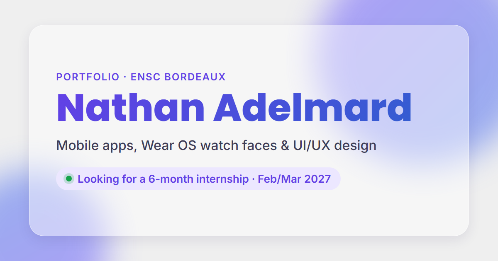

# Nathan Adelmard — Portfolio

**Live site: https://nathan-real.github.io/AdelmardNa-Portfolio/**



Personal portfolio of Nathan Adelmard, engineering student at ENSC (Bordeaux INP), focused on
mobile development and UI/UX design. Available in **English and French** (toggle in the top-left
corner, or `?lang=fr` in the URL).

Currently looking for a **6-month internship starting February or March 2027**.

## Featured projects

| Project | What it is | Stack |
| --- | --- | --- |
| [Swipe Clean](https://github.com/nathan-real/Swipe-Clean) | Android app to sort and clean up photo galleries with swipes | Flutter, Dart, Figma |
| [Modern Edge](https://play.google.com/store/apps/details?id=com.watchfacestudio.modernedge) | Wear OS watch face (6 color variants) | Figma, Watch Face Studio |
| [Radar Time](https://play.google.com/store/apps/details?id=com.watchfacestudio.radartime) | Wear OS watch face (7 color variants) | Figma, Watch Face Studio |
| Delivery app (SNS Solutions) | Figma prototype for pharmacy delivery drivers (i2c student enterprise) | Figma |
| Payment terminal (Madic) | Motion design for gas station cash terminals (i2c student enterprise) | Figma, Jitter |

## Tech stack

- [React 19](https://react.dev/) + [Vite](https://vite.dev/)
- [Framer Motion](https://motion.dev/) (dock and background animations), [react-scroll](https://github.com/fisshy/react-scroll)
- Plain CSS, no UI framework
- Lightweight custom i18n (`src/i18n/`)

## Getting started

```bash
npm install
npm run dev       # local dev server
npm run build     # production build in dist/
npm run preview   # preview the production build
npm run deploy    # build and publish dist/ to the gh-pages branch
```

## Project structure

```
src/
  sections/     page sections (Hero, About, Projects, Experience, Contact)
  components/   Navbar, ProjectCard, MediaGallery, LanguageToggle, background blobs
  data/         projects, skills and links (text fields are { en, fr })
  i18n/         language context and UI strings
  assets/       optimized images and videos
public/         favicon, resumes (PDF), Open Graph image, robots.txt, sitemap.xml
scripts/        optimize-media.sh
```

## Media

Full-size source images and videos are kept locally in `media-originals/` (git-ignored).
`scripts/optimize-media.sh` turns them into resized WebP images and H.264 videos in `src/assets/`
(requires `ffmpeg`):

```bash
bash scripts/optimize-media.sh
```

## License

Code: feel free to take inspiration. Project images, resumes and personal content: © Nathan Adelmard, all rights reserved.
